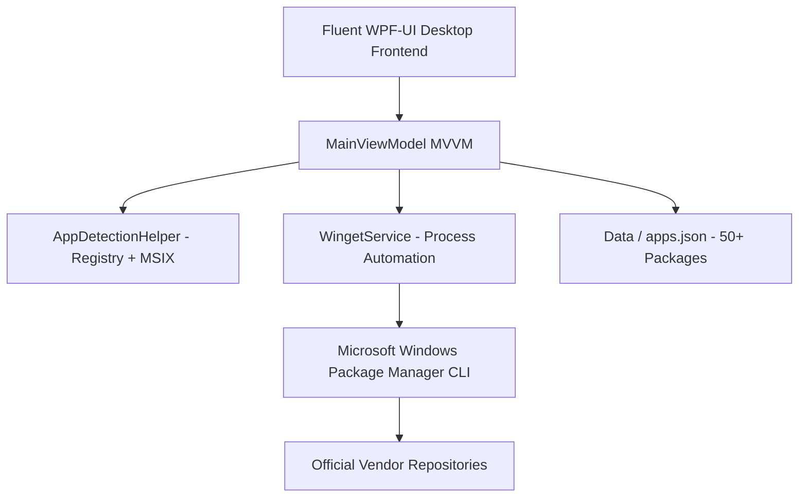

# ⚡ RigForge — Bulk Installer & System Updater for Windows

<div align="center">


### **Effortlessly forge your PC setup with bulk silent installations and system updates.**

[](https://github.com/Sosh79/RigForge)
[](https://dotnet.microsoft.com/)
[](https://wpfui.lepo.co/)
[-2563EB?logo=powershell&logoColor=white)](https://learn.microsoft.com/en-us/windows/package-manager/)
[](LICENSE)

</div>

---

## 📖 Overview

**RigForge** is a modern, high-performance desktop application designed for Windows 10 and Windows 11. Inspired by classic setup utilities like Ninite, RigForge takes PC provisioning to the next level with a clean **Windows 11 Fluent Design** interface, real-time silent automation powered by Microsoft's official **Windows Package Manager (`winget`)**, and official high-resolution application branding.

Whether you just formatted your PC, bought a new machine, or want to keep 50+ software packages updated to their latest official releases with a single click, **RigForge** eliminates repetitive installer clicks, wizard prompts, and bloatware.

---

## ✨ Features

- **🚀 1-Click Bulk Silent Install:** Select any combination of applications from a curated catalog and install them completely unattended in the background without clicking "Next" or "Finish".
- **🔄 Bulk System Upgrade:** Scan all software installed on your machine and upgrade them to their latest official stable versions in one click (`winget upgrade --all`).
- **🔍 Multi-Layer Smart Installed App Detection:** Combines Microsoft's `winget list` engine with deep Windows Registry scanning (HKLM & HKCU Uninstall keys) and MSIX package resolution to reliably detect pre-existing installs (including Google Chrome, Firefox, Discord, Telegram, WhatsApp, and portable tools) and display their active version numbers.
- **🖼️ Official Logos & Visual Thumbnails:** Every application card displays its official high-resolution logo, allowing instant visual recognition at a glance.
- **🎨 Adaptive Fluent Design (Light & Dark Mode):** Built with `WPF-UI` and Windows 11 Mica backdrop. Features adaptive high-contrast palettes that look stunning and guarantee crystal-clear typography in both Light and Dark themes.
- **⚡ 1-Click Curated Presets:**
  - **⭐ Essentials:** Chrome, 7-Zip, VLC, Discord, WinRAR.
  - **💻 Developer:** VS Code, Git, Windows Terminal, Node.js, Python, Docker, Everything Search.
  - **🎮 Gaming:** Steam, Epic Games Launcher, Discord, DirectX, Visual C++ Runtimes.
  - **🎨 Creator & Media:** OBS Studio, Blender, GIMP, Audacity, HandBrake, ShareX.
- **🖥️ Live Diagnostic Terminal Drawer:** Real-time collapsible log console with color-coded diagnostic levels (Success, Warning, Error, Info) and timestamps.
- **📦 Extensible JSON Catalog:** All software definitions live in an editable `Data/apps.json` file. You can add new apps or modify categories without recompiling the codebase.
- **🛡️ 100% Official Sources:** All installations originate directly from verified, official vendor repositories via Microsoft WinGet manifests.

---

## 🛠️ Architecture & Tech Stack



- **Frontend & Presentation:** C# / .NET 8 WPF with [`WPF-UI`](https://github.com/lepoco/wpfui) (Windows 11 Fluent Design System, Mica Backdrop, MVVM Architecture).
- **Core Automation Engine:** Microsoft Windows Package Manager (`winget.exe`).
- **Data Layer:** `System.Text.Json` deserialization over an extensible `apps.json` catalog.
- **Test Suite:** xUnit test suite (`RigForge.Tests`) covering catalog integrity, package uniqueness, and model state management.
- **Web Landing Page:** Modern React 19 + TypeScript + Tailwind CSS showcase located in `/website`.

---

## 🚀 Quick Start

### 1. Run via Pre-built Launcher
1. Download or clone this repository.
2. Double-click **`LaunchRigForge.bat`** (or launch `RigForge.lnk` from your Desktop) to run the application immediately.

### 2. Build from Source

#### Prerequisites
- Windows 10 (Build 1809+) or Windows 11
- [.NET 8.0 SDK](https://dotnet.microsoft.com/download/dotnet/8.0)
- Windows Package Manager (`winget`) — preinstalled on modern Windows 10/11.

#### Build & Run
```powershell
# Clone the repository
git clone https://github.com/Sosh79/RigForge.git
cd RigForge

# Restore dependencies and build in Release mode
dotnet build -c Release

# Publish a standalone, self-contained single executable
dotnet publish RigForge/RigForge.csproj -c Release -r win-x64 --self-contained true -p:PublishSingleFile=true -p:IncludeNativeLibrariesForSelfExtract=true
```

The resulting standalone executable will be generated at:
`RigForge/bin/Release/net8.0-windows/win-x64/publish/RigForge.exe`

---

## 📁 Repository Structure

```text
RigForge/
├── RigForge/                       # Core WPF Desktop Application
│   ├── Assets/                     # Application Icons (.ico, .png) & 50+ App Logos
│   │   ├── app.ico                 # Multi-res Windows executable icon
│   │   ├── app_icon.png            # High-res TitleBar & branding icon
│   │   └── Icons/                  # 51 official software PNG logos
│   ├── Converters/                 # XAML Value Converters (Color, Visibility, Status)
│   ├── Data/
│   │   └── apps.json               # Curated catalog of 50+ software packages
│   ├── Models/                     # SoftwarePackage & Log models
│   ├── Services/                   # WingetService, AppDetectionHelper, ThemeService
│   ├── ViewModels/                 # MVVM ViewModel with reactive commands
│   ├── Views/                      # FluentWindow XAML and code-behind
│   └── RigForge.csproj             # .NET 8 WPF project file
│
├── RigForge.Tests/                 # Unit Tests (xUnit)
│   ├── DataTests.cs                # apps.json schema & ID validation
│   └── SoftwarePackageTests.cs     # State transition & icon resolution tests
│
├── website/                        # Modern promotional landing page (React + Vite)
├── LaunchRigForge.bat              # Quick launcher batch script
├── RigForge.sln                    # Visual Studio / .NET Solution
├── .gitignore                      # Standard .NET & Web exclusions
├── LICENSE                         # MIT License
└── README.md                       # Project documentation
```

---

## ➕ Adding Custom Applications

You can easily expand RigForge's catalog without modifying any C# code. Open `RigForge/Data/apps.json` and append a new package entry using the official `winget` package ID:

```json
{
  "Id": "Vendor.AppName",
  "Name": "My Custom App",
  "Category": "Utilities",
  "Description": "Short description of what the application does.",
  "Icon": "Apps24"
}
```

> **Tip:** You can discover the exact `Id` of any application by opening PowerShell and running:
> ```cmd
> winget search "AppName"
> ```
> To add a logo, place a matching `<Id>.png` file inside `RigForge/Assets/Icons/`.

---

## 🧪 Running Automated Tests

Run the test suite using the .NET CLI:

```powershell
dotnet test
```

---

## 📜 License

This project is open-source and released under the [MIT License](LICENSE).

---

<div align="center">
  <b>RigForge</b> — Built for power users, sysadmins, and gamers who value their time.
</div>
